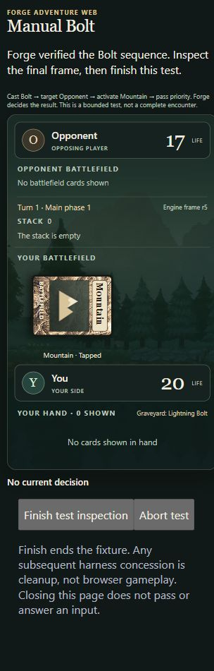

# One approved browser-controlled Bolt session

**Actual result: PASS.** On 2026-10-19 the local browser drove original Forge
through Bolt cast, opposing-player targeting, manual Mountain payment and
priority pass. Forge independently confirmed opponent **20→17**, player 20,
empty stack and Bolt in the human graveyard before cleanup.

Executed reviewed head `bc0d5257cd77b839d8073675056bc35858c686a6` on
`codex/browser-bolt-manual`, stacked on #24. [Waypoint's owner authorization](https://github.com/rwZephyr/forge-adventure-web/pull/28#issuecomment-6278836774)
allowed exactly this command:

```powershell
./experiments/browser-bolt/Run-Manual.ps1 -Label loopback-1 -ApproveListener -BindAddress 127.0.0.1 -Port 8765
```

It was executed **once**. The label is now spent. No fixture retry, alternate
command, source adaptation, dependency acquisition, Safari/Tailscale session,
network/service configuration or merge occurred. This publication changes only
documentation/evidence; the implementation and original offline records remain
unchanged. PR #27 is isolated and remains on execution HOLD.

## Browser actions and authoritative result

The Chrome connector was unavailable during tooling preparation, before the
fixture started. One visible **local Codex in-app Chromium** tab was used instead.
Codex clicked observed UI controls individually through CUA, inspecting each
new prompt. This was an **agent-operated browser test**, not an independently
human-operated usability test or Safari test. No direct API action injection or
Java-object access drove the browser's choices. Actual viewport: **319×571 CSS
pixels**, with vertical scrolling/full-page screenshots; no 390×844 fit claim.

The server capability was read directly into the private UI-input operation,
never printed or placed in a URL. The input was verified empty after Connect.
Only the allowlisted browser frames reached the UI.

| Browser frame | Observed decision/state | Browser action |
| --- | --- | --- |
| r1 | Both life 20, Bolt in hand, Mountain untapped, empty stack | Cast Lightning Bolt |
| r2 | Original player-target choices, Bolt being cast and not yet stacked | Target opponent |
| r3 | Opponent selected, red payment needed, pool 0, untapped Mountain | Activate Mountain; no Auto/OK |
| r4 | Original stack entry Bolt→Opponent, Mountain tapped, opponent still 20 | Pass priority |
| r5 | Opponent 17, player 20, stack empty, Bolt in graveyard | No gameplay choice; inspect, then Finish test inspection |

All five frames arrived in order. The original input remained pending for
**17.329 seconds between the first recorded browser frame and the pre-cast
observation**; the original Java prompt had already been parked before browser
connection. The enabled cast action then dispatched successfully. This is a
bounded think-time observation, not a ten-minute endurance test or proof that
arbitrary EDT work cannot stall.

Original C1 exact-reference checks passed on three genuine questions: initial
Bolt on EDT **tid 127**, additional-cost Bolt on **Game-0 tid 121**, Mountain
on **Game-1 tid 133**. The JVM log independently records original stack target,
`paid=R source=2`, then `human-success aiLife=20->17 stack=0 graveyardBolt=1`.
Capture/authorization checks were not weakened. Physical EDT thread IDs vary
across this headless run; no stable OS/Java EDT thread across human pauses is
claimed. No exception, graph-overlap or atomic-failure diagnostic was recorded;
the reason for EDT thread recreation was not investigated in this slice.



[Initial](../../experiments/browser-bolt/evidence/loopback-1/browser/initial.png) ·
[Target](../../experiments/browser-bolt/evidence/loopback-1/browser/after-cast.png) ·
[Payment](../../experiments/browser-bolt/evidence/loopback-1/browser/payment.png) ·
[Stack](../../experiments/browser-bolt/evidence/loopback-1/browser/stack.png).

## Terminal inspection, shutdown and processes

The [pre-finish observation](../../experiments/browser-bolt/evidence/loopback-1/before-finish.json)
found the loopback listener and **zero cleanup concessions** after the original
damage/graveyard result. Terminal UI had no gameplay choices. Its inspection
was explicitly acknowledged; final DOM retains r5 and reports finish requested,
with both harness buttons disabled. The JVM's success-only concession is a
later cleanup event, about **45 seconds after its human-success observation**.

`manual-host-result.json` records **outcome PASSED, shutdown CLOSED**, empty
transport-failure type, zero rejected requests and
`harnessCleanupIsGameplay:false`. Source ordering calls `host.close()` and
checks its outcome before entering unchanged `finishCleanly`; the successful
run supports that control-flow ordering. No independent network probe was
placed at the exact instant of concession.
No response/status error appeared in the UI or collected console; a full HTTP
status trace was not captured, so individual response codes are not reconstructed.

Fresh TestNG: **1 PASS, 0 failures/errors/skips**, reported 162.2 seconds.
Maven/driver exit **0**, no launcher timeout or forced fixture termination.
The [retained-handle assessment](../../experiments/browser-bolt/evidence/loopback-1/process-assessment.json)
observed the actual chain exit 0: driver 86984 → cmd 79172 → Maven JVM 97712 →
cmd 94580 → Surefire JVM 102244. Surefire exited at
`22:44:37.7813578Z`, Maven at `22:44:37.9004646Z`, driver at
`22:44:38.0000498Z`. The [postflight](../../experiments/browser-bolt/evidence/loopback-1/postflight.json)
found **zero Java processes and zero port-8765 listeners**. No fixture process
was killed; existing services were not terminated.

All **2,086 protected hashes**, **2,393 cache files** and **six parent environment
values** remained unchanged; before/after inventories are byte-identical to the
previously published offline inventory. No downloads or additional installations.

## Diagnostic limitations and observed rough edges

- A screenshot capture after Finish failed once and was **not retried**. The
  genuine pre-cleanup terminal PNG and final post-finish DOM/events survive.
  Browser console warning/error collection returned zero entries. A separate
  read-only user-agent query was unsupported by the browser API; no precise
  Chromium version is claimed. These were inspection-tool limitations, not a
  second fixture execution or fabricated success response.
- Initial sandbox CIM access was denied. Read-only observation outside the
  sandbox retained actual fixture process handles. Its root substring also
  matched the collector's own script, so raw observations preserve an extra
  root (86472). The derived assessment uses the launcher's actual driver PID
  to distinguish the five real descendants. The collector was stopped only
  after all of them exited 0. An initial stop refused because its expected
  timestamp was compared in local time; no process was killed then. A read-only
  UTC check established a 0.0004 ms difference, and only that verified collector
  was subsequently stopped. [Raw observation and stop record](../../experiments/browser-bolt/evidence/loopback-1/manifest.json)
  are preserved; the fixture's no-forced-termination result is unchanged.
- The live status text retains “Connecting…” on an already usable initial
  frame, then “Waiting…” even when a subsequent prompt is actionable. Controls
  and revisions worked; this is a presentation defect for later review, not
  a reason to alter this approved run or its evidence.
- No abort, expiry, hostile-request or reconnect runtime trial was authorized
  in this single session. Their previous direct policy checks are not replaced
  with a runtime claim. No general graph ownership, full encounter, actual
  human usability, iPhone Safari or production hosting claim follows.

The [new evidence manifest](../../experiments/browser-bolt/evidence/loopback-1/manifest.json)
links complete sanitized logs, fresh reports, immutable browser observations,
unedited PNGs, process records and shared inventory. Private originals and the
capability file remain ignored locally. Publication strips Surefire properties,
replaces machine paths/hostnames, normalizes text/VM suffixes and records original
and published hashes/sizes. JSON/XML parses and credential/private-path checks
pass; the actual capability is absent from published text and screenshots show
only the cleared/hidden input. No compiled outputs, profiles or downloaded
JARs/POMs are committed.

Stop for Waypoint's independent review. No further execution, UI correction,
Safari exposure or production expansion is authorized by this result.
