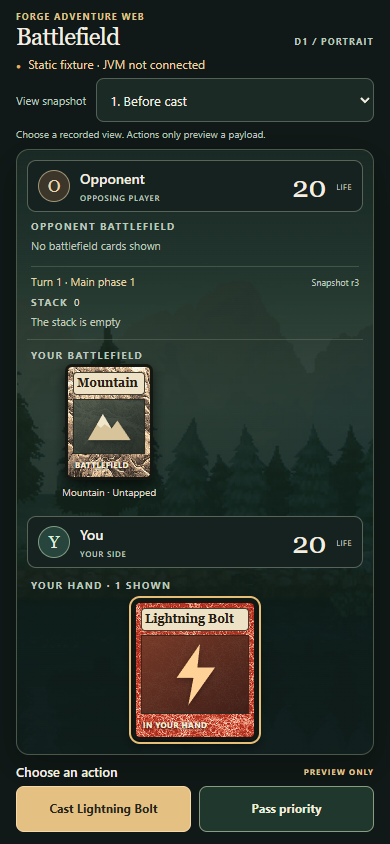

# Stage D1: first visible portrait battlefield

2026-10-18 owner-local date. Stacked on PR #23 at
`f23a1a5b66b2b2a692be9082511eb4b4d3a6433f`. Stage C's bounded milestone is
accepted; D1 adds a static browser presentation and no Java/engine changes.

The [prototype and viewing instructions](../../experiments/battlefield-static/README.md)
need no build or listener: open its `index.html` as a local file. Opponent is
above the player; life totals, the human hand, Mountain's tap state, turn/phase,
stack, selected target and current offered choices come from five original
Forge DTO frames. A separate labeled selector chooses recorded views.
Actions open a typed-payload preview and **do not advance a snapshot or claim
an engine response**. The page prominently says the JVM is not connected.

## Verified

Existing Chrome **155.0.8059.82** and Playwright **1.62.1** rendered local files
over the browser control pipe, with no listener or installation. The actual
Playwright package version is also recorded in the evidence manifest.
The target viewport was **390×844 CSS pixels**, device scale 1, mobile/touch
emulation; this was **Chromium, not Safari**. Real screenshots:

The [browser-check output](../../experiments/battlefield-static/evidence/browser-checks.json)
records these passing checks:

- All five snapshots fit from scroll position zero: document 390×844, contextual
  actions end at y=832. No horizontal overflow; visible tap controls at least
  44×44. Empty hands do not consume a full card-sized panel.
- All **seven** contextual choice previews match the current recorded
  match/session/revision/prompt/choice exactly, with distinct action IDs.
  Opening/closing each preview leaves the board and selected snapshot unchanged.
  Card taps and the opposing-player target tap also open previews.
- Mountain is untapped before payment and sideways/explicitly labeled tapped
  only in the appropriate recorded views. Stack entries/selected targets are
  kept distinct from an in-progress cast. Manual payment offers Mountain,
  without Auto/OK or invented pass choices.
- Life totals reflect the source: both start at 20; only the manually selected
  post-resolution snapshot shows opponent 17. No damage calculation runs here.
- Schema checks reject extra DTO keys and confirm no opponent card identities
  in these fixtures; the static data is frozen. Offline extraction matches the
  original published frames at source lines 333, 371, 400, 437 and 463.
- Keyboard Enter opens the preview and Escape closes it. Additional 320×720,
  390×667 and 844×390 viewports have no horizontal overflow; vertical scrolling
  is allowed outside the target size. No hover interaction is required.
- Zero page/console errors and zero attempted HTTP(S) page requests. The browser
  context closed; a subsequent profile-specific process check found no remaining
  prototype Chrome root. Other browser profiles/services were not altered.

The [evidence manifest](../../experiments/battlefield-static/evidence/manifest.json)
records source/screenshot hashes, sizes, asset provenance and capture timestamps.
The [README commands](../../experiments/battlefield-static/README.md#optional-checks-with-existing-tools)
reproduce the checks with existing tools and fresh output locations.

Development inspection caught a scrolled screenshot that cropped the masthead;
the initial check did not reset dialog-induced scrolling. The corrected strict
check rejected an 870px document. Spacing and empty-hand sizing were adjusted;
the final source passes the full top-of-page 844px check. Earlier development
captures remain private and are not the published final screenshots.

## Limits and next bounded step

**Not verified:** actual iPhone Safari rendering, browser-toolbar/safe-area
behavior, VoiceOver, or communication with a JVM. CSS accommodates Safari safe
insets via `env(safe-area-inset-*)`, keeps zoom enabled and uses semantic native
buttons/select/dialog; Chromium emulation does not establish real iOS behavior.

Original Forge assets are referenced in place with attribution and hashes;
no official card illustrations, fonts or packages were downloaded. No Maven or
Java run, backend adaptation, network listener, WebSocket, account, deployment,
deck builder, Adventure scene, rules logic or merge was introduced. PR #22/#23
tests and historical evidence remain unchanged.

Next: review this visible static battlefield. A subsequent approved connection
must replace historic fixture handles with live viewer-specific snapshots and
authoritative original-controller receipts, preserve Stage C's validation and
capture constraints, and obtain separate approval for any transport/listener
and actual Safari testing. No connection work is implemented in D1.
