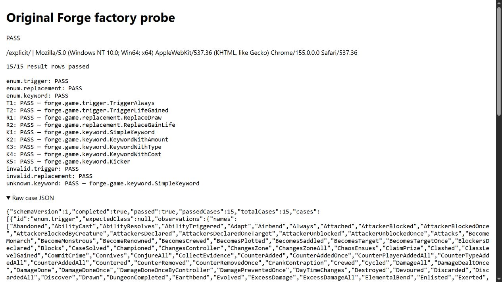
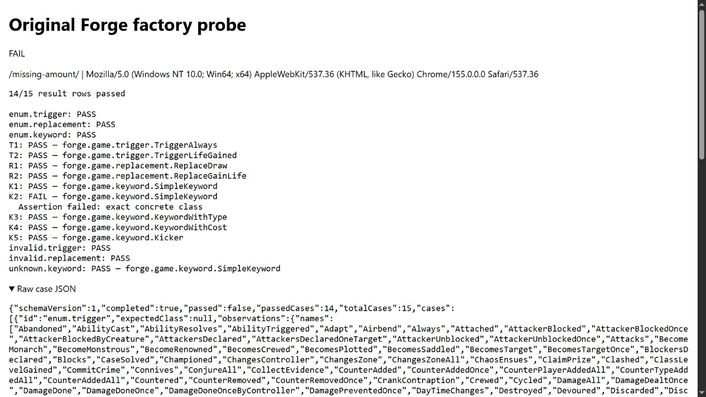

# Stage A results on Silent

Date: 2026-10-17 (America/Vancouver). Original source baseline
`db893dcdb14fdd85a05437ad458dc70ef704ca2e`; implementation branch
`codex/gate2-factories`, based on the approved PR #9 design. PR #8 stays separate
and unmerged. **Stage B was not implemented or tested.**

## Outcome

**Verified: Stage A passes on desktop Chromium 155 with explicit constructor
metadata. It fails with compiler defaults.** All 15 explicit result rows match
the actual JVM comparator across three page loads. With only
KeywordWithAmount's constructor metadata withheld, exactly K2 fails across three
loads: the original Keyword factory silently returns SimpleKeyword, amount 1,
and the concrete-class assertion catches it. The other 14 rows match JVM.

| Run | Actual compilation | Actual browser behavior |
| --- | --- | --- |
| Original core/game Maven closure | Offline JDK 17 compile: BUILD SUCCESS, 14.845 s, zero Checkstyle violations; 154 core and 822 game source files compiled. | JVM control passed all 15 rows. No game launched. |
| TeaVM default | JavaScript generation succeeded, zero severe compiler problems. | 5/15 rows pass; TriggerType cannot find TriggerAbandoned's constructor; both replacement factories fail; K2–K5 silently become SimpleKeyword and fail class checks. Three identical runs. |
| TeaVM explicit metadata | JavaScript generation succeeded, zero severe compiler problems. | 15/15 rows pass and all observations match JVM on three loads. |
| Missing-amount metadata | JavaScript generation succeeded, zero severe compiler problems. | 14/15 rows pass, only K2 fails with SimpleKeyword/BUSHIDO/amount 1. Negative comparator passes on three loads. |
| Comparator self-checks | Seven mutation-based Python tests passed. | These test the comparator, not browser execution. |

The nine factory rows exercise original TriggerAlways, TriggerLifeGained,
ReplaceDraw, ReplaceGainLife, SimpleKeyword, KeywordWithAmount, KeywordWithType,
KeywordWithCost and Kicker. Six additional rows cover enum inventories, invalid
names and unknown-keyword behavior. Exact class equality, amounts/types/mana,
intrinsic propagation, copied parameters and selected original predicates passed.
Default invalid-trigger testing also fails after enum initialization fails; it
does not miscount a poisoned-enum exception as a valid unknown-name rejection.

The temporary server was approved separately, served only `build/web`, bound to
127.0.0.1:8765 and stopped after each validation session. The final check found
no listener. No network configuration, LAN exposure, Tailscale, other service,
user save, account or system dependency installation changed. Browser tabs closed.
Pages' uncaught-error display and console warn/error capture remained empty for
the final explicit and negative runs; expected case failures remain visible in
JSON. HTTP requests returned 200/304; no 404/500 was recorded. Empty TeaVM error
stack arrays are retained as observed, not filled with invented frames.

## Actual commands and evidence

Commands ran from repository root:

```powershell
./experiments/rules-teavm/scripts/Prepare-Forge.ps1
./experiments/rules-teavm/scripts/Invoke-Probe.ps1 -Task jvmControl -WriteLocks
./experiments/rules-teavm/scripts/Invoke-Probe.ps1 -Task browserDefault -WriteLocks
./experiments/rules-teavm/scripts/Invoke-Probe.ps1 -Task browserExplicit -WriteLocks
./experiments/rules-teavm/scripts/Invoke-Probe.ps1 -Task browserMissingAmount -WriteLocks
./experiments/rules-teavm/scripts/Invoke-Probe.ps1 -Task dependencyInventory -WriteLocks
python experiments/rules-teavm/scripts/test_compare_results.py
python experiments/rules-teavm/scripts/collect_evidence.py
```

After the harness/manifest corrections below, variants were rebuilt without
`-WriteLocks`. Final variant output directories are cleaned before generation,
with their canonical paths checked to stay inside this experiment, so failed
builds' debug sources cannot leak into the final artifacts. Builds remain offline.
The clean rebuilds preserved the tested JS/HTML bytes exactly; see
[clean-output-comparison.json](evidence/clean-output-comparison.json).
Exact successful timings/classes/methods, artifact sizes/hashes and all initial
compiler errors are in [build-results.json](evidence/build-results.json) and
[artifacts.json](evidence/artifacts.json). Original source/class/POM hashes are in
[input-manifest.json](evidence/input-manifest.json). The full readable logs are
committed, not merely their hashes.

Oracle JDK 17.0.12+8-LTS-286, portable Maven 3.9.16 / Gradle 9.6.1, gdx-TeaVM
1.6.1, libGDX 1.14.2, TeaVM 0.15.0 and existing Python 3.12.10 were used with
isolated caches. Every build used one Gradle worker, capped JVMs and sequential
compiler processes. No downloads or system-wide settings changes were needed.

Warnings retained: the annotation processor advertises RELEASE_11 while javac
uses release 17; compiler source-copy API usage is deprecated; Gradle reports
deprecated features for a future Gradle 10 upgrade. Current pinned builds succeed.

The final runtime JS files are approximately 1.21 MB default, 2.35 MB explicit,
2.34 MB missing-amount, uncompressed and instrumented. They are not full-game
sizes or performance estimates. Runtime and compiler dependency inventories have
62 configuration entries / 57 distinct coordinates, with SHA-256 hashes. Cached
POM license declarations were resolved for all 57, including inherited licenses:
see [dependency-licenses.json](evidence/dependency-licenses.json). JGraphT declares
LGPL-2.1 and EPL-2.0 choices; other declared licenses include Apache-2.0 and MIT.
This inventories declarations, not legal clearance for a public package.

For approved browser serving, the documented foreground command is:

```powershell
./experiments/rules-teavm/scripts/Serve-Loopback.ps1 -Approved
# Visit /default/, /explicit/, /missing-amount/ under http://127.0.0.1:8765/.
# Reload each three times; export the actual case JSON; stop with Ctrl+C.
```

In this task, existing Python's identical http.server command ran hidden with
stdout/stderr recorded, after explicit approval. It was stopped by its recorded
PID only after checking that process's executable/arguments matched this exact
experiment. Serving lifetime was limited to testing. Reproduction still requires
separate owner approval before starting a listener.

[comparisons.json](evidence/comparisons.json) contains six successful browser/JVM
comparisons, including three expected negative outcomes. Nine actual page JSON
exports, browser identity/AX diagnostics and screenshots accompany it. See
[README.md](README.md) for complete reproduction and comparator commands.

## Failures and bounded corrections

1. **Harness constant error:** the design used ManaCostShard.R; Forge's enum
   constant is RED. The first javac failure is retained in
   [initial-harness-compile.log](evidence/initial-harness-compile.log). Corrected
   only the harness/design reference. Original mana parsing is still tested.
2. **Harness resource configuration:** adding the compiler resource directory
   twice caused Gradle's duplicate-service-file failure. Changed `srcDir` to
   `setSrcDirs`; [failed log](evidence/initial-compiler-resources.log) retained.
3. **Real compiler closure failure:** the initial explicit and negative builds
   each reported **47 severe errors**, including missing locks, ClassLoader
   resources, ProcessHandle/management APIs, SQL/file-lock classes, StringJoiner,
   date conversions, Constructor.canAccess and Normalizer.NFKD. The base-typed
   predicate call caused TeaVM to retain ReplaceDraw.canReplace and broader
   trigger implementations, reaching Game/tinylog/Sentry/Commons behavior outside
   the selected cases. The harness now calls only the already-approved concrete
   TriggerAlways, TriggerLifeGained and ReplaceGainLife predicates after exact
   class assertions. This narrower call surface compiles. No dependency removal,
   old-version substitution, logger stub, JDK emulation, factory rewrite or Forge
   edit was used. Full failed logs remain:
   [explicit](evidence/initial-explicit-virtual-dispatch.log),
   [negative](evidence/initial-missing-amount-virtual-dispatch.log).
4. **Incomplete metadata manifest:** an initial source pattern missed
   `DayTimeChanges (TriggerDayTimeChanges.class)` because of whitespace. The
   resulting explicit browser run passed 11/15 rows and failed enum startup.
   The apparent missing-metadata problem was our generator omission, not a
   TeaVM defect. The generator now handles whitespace and checks all source
   mapping names against the actual JVM inventory. Correct counts are **149
   entries / 137 distinct trigger classes**, plus two replacement and five
   keyword constructors: **144 explicit signatures**, **143 negative**. Both
   factories/enums remain complete and unchanged. The initial
   [browser result](evidence/initial-incomplete-manifest-browser.json) and
   [compiler log](evidence/initial-incomplete-manifest-explicit.log) are retained;
   the approved design's counts were corrected in this implementation branch.

The final generated JS metadata inventory verifies every explicit constructor
and exactly one omission in the negative artifact. Source references copied for
debugging preserve the original source; no Forge source transformation was added.
See [reflection-metadata.json](evidence/reflection-metadata.json) and the 22
[source-copy checks](evidence/source-copy-checks.json), normalized only for newlines.

## Limits, blockers and recommended next action

**Verified:** this bounded factory/predicate surface works in desktop Chromium
with explicit constructor metadata and catches a genuine silent keyword fallback.
All TriggerType constructors are discoverable at enum startup; only two trigger
and two replacement products are instantiated by the test. This does not verify
every constructor body or every specialized keyword, createTraits, event dispatch,
AbilityFactory/ApiType, a real Game, AI, Adventure, Safari or touch.

**Blocked for broader reachability:** the retained initial compiler errors show
that widening dispatch reaches desktop logging/platform dependencies and
unsupported JDK methods. Narrowing this test is not evidence those paths work.
No broad workarounds were attempted, and no full rules-engine compatibility is
claimed. The default variant remains a verified reflection failure.

**Recommended next action:** review this Stage A draft PR, then run the unchanged
SpriteGroup and factory artifacts on an actual iPhone Safari through an agreed
private arrangement. Keep PR #8 unmerged until its device gate is resolved. Only
after a separate Stage B review/approval, investigate genuine bootstrap and the
AiController threaded spell path. Expect a new dependency/reachability boundary;
do not infer AI feasibility from these factory results.




